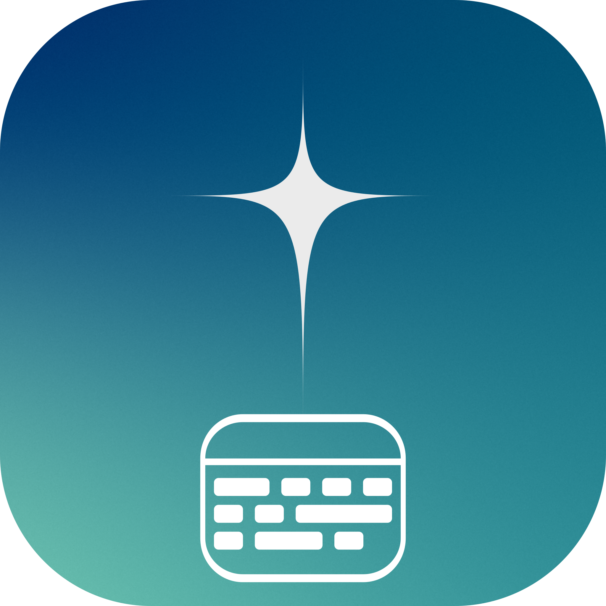

<!-- gh-header -->
<div align="center">



# datist

**calendar with google sync and the hour grid**

   

</div>

<p align="center"></p>

<p align="center"><!-- gh-note --><sub>tip: the glass button (󰃝, top right) makes the window see-through, like the terminal – needs a compositor with blur, e.g. hyprland.</sub></p>

calendar in the terminal look of the suite (gtk4): week and month view with the TU Berlin hour grid
(double periods, even/odd calendar weeks), categories, repeating events, multi-day events, offline storage and
sync with google calendar.

## install – linux

```bash
gh auth login                                   # login once (repository is private, invitation needed)
gh repo clone danger-inc/datist ~/datist-src
cd ~/datist-src && ./install.sh
```

the installer asks for the system packages (gtk4, pygobject – password once), copies datist to
`~/.local/share/rice-apps/calendar` and creates the command `datist` and a menu entry. the icons are bundled,
no nerd font needed.

start with `datist` (or from the menu). calling it again shows/hides the window.
hyprland: `hl.bind("SUPER + K", hl.dsp.exec_cmd("datist"))` or `bind = SUPER, K, exec, datist`.

## install – windows 10/11

1. download the repo (on github **code → download zip** and extract, or `gh repo clone …`).
2. double-click **`install-windows.bat`** in the folder.

the script sets up **msys2** once (provides gtk 4 and python for windows, ~1 gb, asks for admin rights),
installs the packages and adds datist to the start menu. removal: `uninstall-windows.bat`.
on windows ✕ exits datist (on linux it keeps running in the background).

## runs on

| system | status |
| --- | --- |
| ubuntu 24.04+, linux mint 22+, debian 13 | tested (ubuntu 24.04) |
| fedora 39+ | tested (fedora 44) |
| arch, endeavouros, cachyos, manjaro | tested (arch) |
| openSUSE Tumbleweed | should work (untested) |
| windows 10/11 | via msys2 – app start tested, installer on real windows still untested |

required is **gtk 4.12 or newer** (ubuntu 22.04 / mint 21 / debian 12 are too old).
on gnome, kde and windows the window has a normal frame (move it by the header, resize at the edge);
on hyprland/sway & co. it is borderless.

## google sync

under "konto" in the app. google requires your own oauth client (type "desktop app"); the app walks you through it
step by step. login and events stay on your machine (`~/.local/share/kalender`,
`~/.config/kalender`). optional: put your google address into `~/.config/kalender/login_hint` – then google
suggests the right account right away when you sign in.

## update / remove

* linux: `./update.sh` · `./uninstall.sh` (your events stay)
* windows: get the new version and run `install-windows.bat` again · `uninstall-windows.bat`

## problems?

* **boxes instead of symbols:** install again or `./update.sh` – the icon font comes along.
* **`datist: command not found`:** `~/.local/bin` is missing in `PATH` (the installer shows what belongs in
`~/.bashrc`). from the application menu it starts anyway.
* **"GTK … ZU ALT" during install:** your distribution is too old, see "runs on".

<!-- gh-suite -->
## the -ist suite

all apps share one look (terminal style, colors from your wallpaper via matugen), one installer and the same shortcuts.

| app | what it does |
| --- | --- |
| [scourge](https://github.com/danger-inc/scourge-public) | inspect, edit, record, cut – and installs the others |
| [notist](https://github.com/danger-inc/notist-public) | notes · words · latex |
| [filist](https://github.com/danger-inc/filist-public) | file explorer + file dialog |
| [mailist](https://github.com/danger-inc/mailist-public) | mail |
| [musicalist](https://github.com/danger-inc/musicalist-public) | youtube music |
| [linguist](https://github.com/danger-inc/linguist) | translator + hover corner |
| [sharist](https://github.com/danger-inc/sharist) | quick share |
| [wallist](https://github.com/danger-inc/wallist) | wallpapers |
| [inquirist](https://github.com/danger-inc/inquirist) | launcher |

dotfiles with the matching hyprland setup: [danger-inc/dotfiles](https://github.com/danger-inc/dotfiles)

## In der Leiste (Waybar & Co.)

`datist` hat eine schnelle Kommandozeile ohne Fenster (liest nur den lokalen Zwischenspeicher):

```
datist --next          # nächster Termin als eine Zeile
datist --agenda 7      # die nächsten 7 Tage als Text
datist --json 14       # dieselben Termine als JSON für eigene Skripte
datist --waybar        # JSON für ein Waybar-Modul
```

Waybar-Modul (`config.jsonc`, dazu `"custom/datist"` in `modules-right`):

```jsonc
"custom/datist": {
    "exec": "datist --waybar",
    "return-type": "json",
    "interval": 60,
    "signal": 8,
    "on-click": "datist",
    "on-click-right": "datist --bar-hide",
    "tooltip": true
}
```

Klassen für das Styling: `none`, `later`, `today`, `soon` (≤ 15 min), `now` (läuft), dazu `exam` bei einer Prüfung in den nächsten 3 Tagen.

Styling (damit der Block lesbar ist und zum Design passt, `style.css`; `@…` sind die Farben deines Designs):

```css
#custom-datist { color: @foreground; padding: 0 12px; margin: 6px 4px; border: 1px solid alpha(@primary, 0.55);
                 border-radius: 6px; }
#custom-datist:hover { background-color: alpha(@primary, 0.22); }
#custom-datist.soon { color: @tertiary; border-color: @tertiary; }
#custom-datist.now  { color: @on_primary; background-color: @primary; }
```

Rechtsklick öffnet ein Menü (Beispiel: `scripts/datist-menu.sh` mit wofi) zum Verstecken (`datist --bar-hide [once|series]`, `--bar-off`, `--bar-show-all`, `--bar-info`); `"signal": 8` lässt datist sie sofort
aktualisieren. Wieder einblenden: im Menü oder unter datist → Einstellungen → „leiste & desktop“. Desktop-Karte ein/aus: `datist --desk`. Wer die linke Seite eng haben
will, setzt `clock`, `custom/datist`, `pulseaudio` usw. in eine Gruppe (`"group/left"`), dann gilt der globale
`"spacing"` nicht dazwischen.
